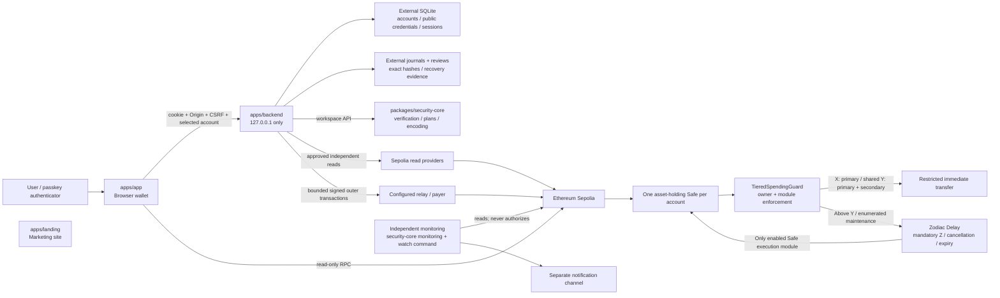
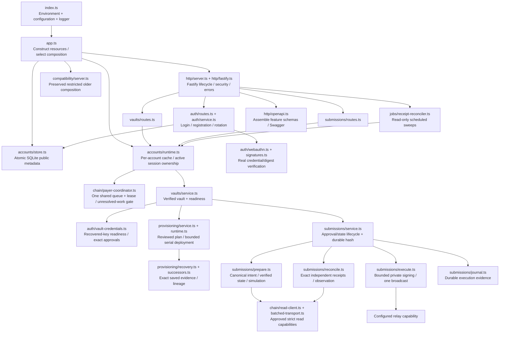

# Current codebase map

Snapshot: 2026-11-12. See the [file-by-file guide](file-guide.md) for every tracked file. The approved backend domain reorganization is reflected below. Formatting/linting scope remains `apps/backend`.

## Workspace layout

```text
apps/
  app/                    Browser wallet: routes, account state, passkeys, reads
  backend/                Loopback API: sessions, provisioning, Safe submissions
  landing/                Separate public marketing site
packages/
  security-core/
    contracts/            Guard, approved maintenance/setup helpers, test contracts
    src/                  Policy, signers, topology, queue, provisioning, transport, monitoring
    scripts/              Review, verification, local/live rehearsal and evidence commands
    config/               Committed profiles, policies, deployment/artifact anchors
    test/                 Unit, real-Safe integration, invariant tests and fixtures
    docs/                 Research, security decisions, runbooks, plans and public evidence
    legacy/               Quarantined 2024 experiment; no current security authority
docs/                     Repository-wide engineering guides and recent tooling plans
```

## Runtime and trust boundaries



The browser can read chain state and request exact passkey approvals. It cannot choose deployment artifacts, relay secrets, RPC identities, nonces, arbitrary calldata or policy overrides through this API. Cookie authentication is separate from spending approval. Safe, the guard and Delay enforce custody policy onchain. The diagram describes the implemented ordinary-Safe prototype; the proposed native ERC-4337 replacement remains separately gated. Monitoring implementation does not prove independent alert delivery or complete the live/audit gates.

## Backend composition

The backend is organized by workflow ownership. `index.ts` starts the process; `app.ts` constructs dependencies and owns cleanup. Every feature's `routes.ts` adapts HTTP, while services perform the workflow. There is no extra transaction forwarding service.

```text
apps/backend/src/
  index.ts                         Executable startup
  app.ts                           Import-safe application composition
  logging.ts                       Native Pino privacy/display configuration
  config/                          Environment loading and validated settings
  http/                            Fastify, security, errors, health and OpenAPI assembly
  accounts/                        SQLite metadata, account projection and runtime cache
  auth/                            Setup/login/registration, vault credentials and cryptography
  vaults/                          Verified vault lifecycle, readiness and operation coordination
  provisioning/                    Immutable deployment workflow and restart recovery
  submissions/                     Preparation, approvals, execution, receipts and journals
  chain/                           Shared RPC adapters and payer-wide coordination
  jobs/                            Non-overlapping receipt scheduling and shutdown drain
  compatibility/                   Preserved singleton/test/HTTPS behavior and old submission API
```



The normal local account API still has 13 method/path operations. The compatibility composition still has 10, including singleton credential rebind. Their generated OpenAPI objects are structurally identical to the pre-refactor contracts. Schemas describe the API and are not attached to runtime validation.

## Responsibility rules

| Area | Owns | Boundary |
| --- | --- | --- |
| `index.ts` | Process startup, environment loading and startup diagnostics. | Import-safe factories live elsewhere. |
| `app.ts` | Construct stores/runtimes/server and close owned resources. | Workflow logic stays inside features. |
| `http/` and feature routes | Parse HTTP inputs/context, enforce HTTP access checks, apply cookie/session actions and send safe responses. | Routes delegate application ordering to services. |
| `accounts/` | Public account/session/credential metadata, account projection and runtime ownership. | SQLite status cannot replace canonical execution evidence. |
| `auth/` | Registration/login/rebind/approval proof and session transitions. | Browser login never substitutes for an exact Safe approval. |
| `vaults/` | Verified vault identity, readiness and closed operation coordination. | Uses existing core/provisioning/submission capabilities. |
| `provisioning/` | Reviewed immutable deployment, quote/authorization composition and exact recovery lineage. | Recovery verifies recorded progress; it cannot invent a replacement transaction. |
| `submissions/` | Prepared intent, required approval order, durable state, bounded execution and canonical receipts. | Receipt reconciliation receives no private signer or broadcast capability. |
| `chain/` | Approved readers, strict batching, pre-signed-envelope relay and shared payer exclusion. | One payer coordinator spans every account and rechecks authoritative journals before writes. |
| `jobs/` | When to run another receipt sweep; shutdown drains active work. | Scheduling has no approval or signing authority. |
| `compatibility/` | Preserved older test/restricted HTTPS composition and APIs. | Historical profiles remain read-only. |

`accounts/types.ts`, `vaults/types.ts` and `submissions/types.ts` own application contracts; application code no longer imports these contracts from a server or bootstrap file. Shared RPC helpers no longer come from the deployment service. Authentication routes apply returned session/cookie transitions before account projection, preserving response/error ordering.

## Main flows

| Flow | Files and responsibility |
| --- | --- |
| Start | `index.ts` loads the selected external configuration, then `app.ts` builds resources and starts Fastify. |
| Create/sign in | Auth routes/service, account projection/store and WebAuthn verifier; proof/counter/session rotation ordering is preserved. |
| Register | Registration route/service enforce immutable role setup and first-key authentication before secondary setup. |
| Provision | Account runtime obtains the shared payer lease, then vault/provisioning services run the exact existing seven-transaction workflow and verification. |
| Send | Canonical intent → verified snapshot/classification/simulation → exact approvals → revalidation → bounded envelope → durable hash → one broadcast. |
| Reconcile | Exact saved hash → independent canonical receipts → public durable observation. No replacement signing. |
| Queue | Existing exact approved operation enters Delay; cooldown, execution, cancellation and expiry remain core/onchain responsibilities. |
| Inspect API | Feature schemas/operation catalogs → OpenAPI assembly → read-only Swagger under the same HTTP boundary. |

## What changed from the old layout

| Previous file | Current ownership |
| --- | --- |
| `main.ts` | `app.ts`; executable startup stays in `index.ts`. |
| `account-server.ts` | `http/server.ts`; shared contracts moved into feature `types.ts` files. |
| `account-runtime.ts` | `accounts/runtime.ts`; global queue/lease checks extracted into `chain/payer-coordinator.ts`. |
| `account-store.ts` | `accounts/store.ts`; atomic SQLite operations kept together. |
| `handlers.ts` | `vaults/service.ts`, credential proof/readiness in `auth/vault-credentials.ts`, contracts in `vaults/types.ts`. |
| `vault.ts` | Durable current lifecycle in `submissions/service.ts`, contracts in `submissions/types.ts`, older API in `compatibility/submission.ts`. |
| `submission-runtime.ts` | Composed `submissions/runtime.ts` with focused preparation/execution/reconciliation/read adapters. |
| `provisioner.ts` | Workflow in `provisioning/service.ts`, concrete composition in `provisioning/runtime.ts`, shared readers/relay in `chain/`. |
| `automatic-recovery.ts`, `managed-successors.ts` | `provisioning/recovery.ts`, `provisioning/successors.ts`. |
| `server.ts`, `session.ts`, older routes | `compatibility/server.ts`, `registration-sessions.ts`, `routes.ts`. |
| `http/openapi.ts` monolith | Feature-owned `schemas.ts` files plus small shared helpers/assembler. |
| `services/transaction-service.ts` | Removed forwarding-only class; routes consume the existing gateway contract directly. |

## Verification and remaining boundaries

Preservation proof includes unchanged public OpenAPI contracts; real cryptographic login/registration tests; session revocation during proof; actual-Safe provisioning/submission/queue/cancellation/restart tests; shared-payer and unresolved-hash rejection; canonical provider/receipt validation; and explicit backend-relative `.env` selection. The observer source identity now hashes the composed extracted implementation, rather than only its former monolithic source file. This changes diagnostic provenance identity, not transaction authorization or receipt validity.

No contract, dependency, pinned artifact, X/Y/Z policy, signer semantics or browser write boundary changed in the domain reorganization. Independent alert delivery, live Sepolia and audit gates remain separate. The exact responsibility of every current file is listed in the [file guide](file-guide.md).
