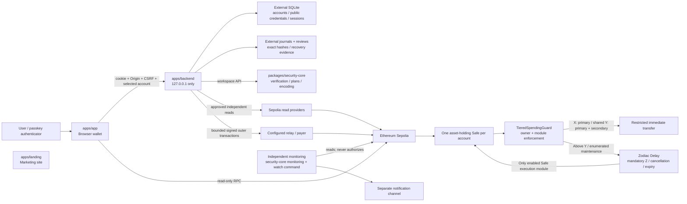
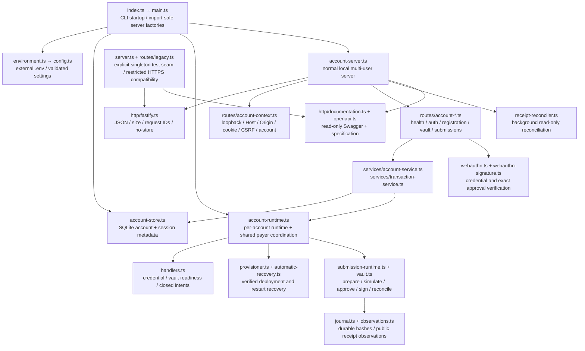

# Current codebase map

Snapshot: 2026-11-12. See the [file-by-file guide](file-guide.md) for every tracked file. Formatting/linting changes in this task apply only to `apps/backend`. No files were relocated.

## Workspace layout

```text
apps/
  app/                    Browser wallet: routes, account state, passkeys, reads
  backend/                Loopback API: sessions, provisioning, Safe submissions
  landing/                Separate public marketing site
packages/
  security-core/
    contracts/            Guard, approved maintenance/setup helpers, test contracts
    src/                  Policy, signers, topology, queue, provisioning, transport, monitoring
    scripts/              Review, verification, local/live rehearsal and evidence commands
    config/               Committed profiles, policies, deployment/artifact anchors
    test/                 Unit, real-Safe integration, invariant tests and fixtures
    docs/                 Research, security decisions, runbooks, plans and public evidence
    legacy/               Quarantined 2024 experiment; no current security authority
docs/                     Repository-wide engineering guides and recent tooling plans
```

## Runtime and trust boundaries



The browser can read chain state and request exact passkey approvals. It cannot choose deployment artifacts, relay secrets, RPC identities, nonces, arbitrary calldata or policy overrides through this API. Cookie authentication is separate from spending approval. Safe, the guard and Delay enforce custody policy onchain. The diagram describes the implemented ordinary-Safe prototype; the proposed native ERC-4337 replacement remains separately gated. Monitoring implementation does not prove independent alert delivery or complete the live/audit gates.

## Backend composition



`server.ts` is not the normal local multi-user server. `main.ts` selects `account-server.ts` for the local CLI and retains the older composition for the explicit test injection seam and restricted non-local compatibility. The normal account server has 13 method/path operations. The older composition has 10, including its two credential rebind operations. Swagger reflects the composition actually running.

## Main flows

| Flow | Current files / responsibilities |
| --- | --- |
| Start | `index.ts` loads external environment before config validation; `main.ts` constructs store, gateway, server and shutdown resources. |
| Create/sign in | Auth routes + `AccountService` + SQLite store + WebAuthn verifier. First-key login rotates the browser session; second-key possession does not log in. |
| Register | Registration routes consume one-use role challenges. First-key authentication precedes secondary setup. Public metadata persists externally. |
| Provision | Account gateway → handlers/provisioner → security-core plan, quote and authorizer → exact serial deployment journal → six-confirmation topology verification. |
| Send | Closed intent → verified snapshot/classification/simulation → prepared digest → primary and optional secondary assertions → revalidation → bounded payer envelope → durable hash → one broadcast. |
| Reconcile | Stored exact hash → independent canonical receipt reads → durable observation. Never sign a replacement simply because a result is uncertain. |
| Queue | Exact approved operation → Delay → mandatory cooldown → execute, cancel or expire according to policy. |
| Inspect API | `/documentation/`, JSON/YAML specification and bundled static assets. Existing server checks and no-store apply; write console is disabled. |

## Reorganization candidates

These are review suggestions, not approved security changes. File sizes are useful clues; responsibility and authority boundaries should decide the split.

| Priority | Current concentration | Suggested boundary | Why / condition |
| --- | --- | --- | --- |
| 1 | `apps/app/src/lib/vault-store.tsx` (~2,100 lines) | Separate account/session client, onboarding, submission state, chain-backed projection, and React provider. | One provider currently couples browser transport, authentication, setup, approval flows and presentation state. Keep screens advisory and preserve exact approval sequencing. |
| 2 | Backend `submission-runtime.ts` (~940 lines) and `vault.ts` (~820 lines) | Separate pinned read adapters, intent preparation/simulation, outer transaction execution and submission state machine. | Runtime composition and transaction lifecycle are difficult to review together. Move only behind existing capability interfaces and security tests. |
| 3 | Backend `provisioner.ts` (~860 lines) | Separate plan construction, quote/authorization, serial execution and completed/prefix recovery composition. | Recovery and fresh deployment share invariants but have different broadcast authority. Preserve exact nonce and evidence gates. |
| 4 | Backend `handlers.ts` (~475 lines), `account-runtime.ts`, `account-store.ts` and `journal.ts` | Clarify who owns credential lifecycle, per-session attempts, shared payer lease, SQLite metadata and append-only execution evidence. | Several layers coordinate state; their responsibilities are more significant than cosmetic folder changes. Journals must remain authoritative for exact transaction hashes. |
| 5 | `security-core/src/pwa/` mixes provisioning, recovery, intents, observation and profiles | Group by domain after documenting public interfaces; keep one stable export boundary. | `backend-api.d.ts` manually describes a large runtime API while `index.ts` re-exports implementation. Review drift risk before splitting packages. |
| 6 | Live scenario scripts accumulate successor/proposal/certificate/report variants | Separate reusable evidence primitives from scenario-specific entrypoints. | Do not collapse historically distinct evidence or overwrite committed packages; filenames encode lineage and approval scope. |
| 7 | Root npm, yarn and pnpm lockfiles; nested security-core npm lockfile | Choose/document one install workflow, then remove obsolete lockfiles in a separate reviewed change. | Current workspace uses pnpm and `workspace:*`; mixed snapshots obscure reproducibility. This task updates only pnpm's lockfile. |
| 8 | Large `http/openapi.ts` contract catalog | Keep schema definitions and per-domain operations together if it grows. | It intentionally describes rather than changes runtime validation. Route coverage tests must continue to catch undocumented additions. |

A reasonable next order is: agree domain ownership, extract the browser transport/state pieces, isolate backend read adapters from execution, then reorganize provisioning/recovery and scenario tooling. Each extraction needs behavior-preserving tests around authentication, exact transaction binding, journal recovery and payer serialization. Moving folders alone will not simplify those boundaries.

The scoped lint setup keeps strict production TypeScript rules. Tests allow explicit `any` for deliberately malformed RPC/ABI fixtures and CommonJS resolution used by the existing harness. Existing late-bound handler callbacks carry narrow `prefer-const` exceptions so applying lint does not change initialization timing.

## Logging follow-up

The backend now uses Fastify/Pino directly: safe request/response serializers, native `reqId` and response timing, request-scoped handler logs and a shared server logger for receipt reconciliation. Development CLI output is formatted with `pino-pretty`; production remains JSON. `src/index.ts` and `scripts/profile-verification-cli.ts` are executable entrypoints. Their imported implementation modules have no execution-detection guards or startup side effects.
