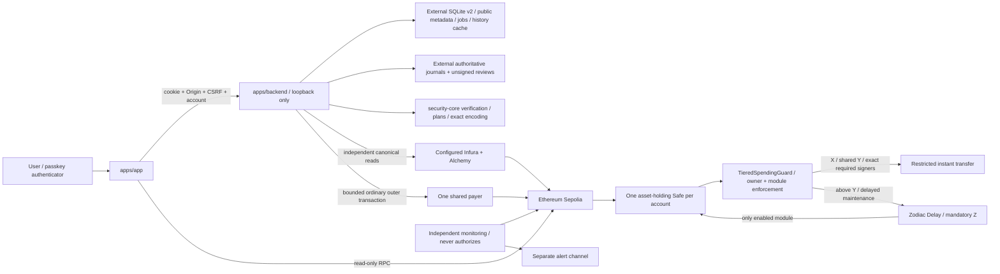
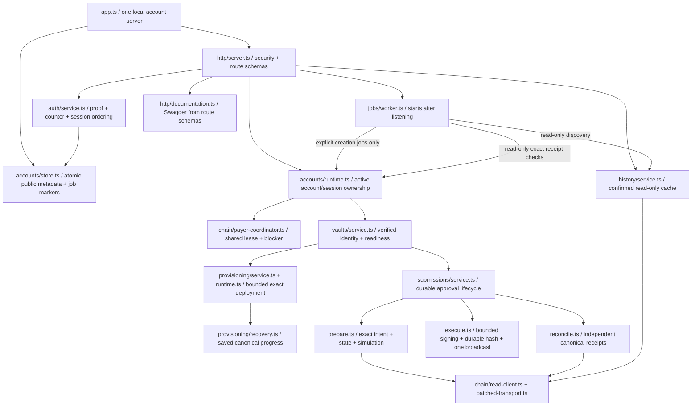

# Current codebase map

Snapshot: 2026-11-12, after the approved minimal-backend change. See the [file guide](file-guide.md) for file responsibilities and the [backend README](../apps/backend/README.md) for current configuration.

## Workspace layout

```text
apps/
  app/                    Browser wallet: routes, account state, passkeys, verified reads
  backend/                Local accounts, background creation, Safe submissions, history
  landing/                Separate public marketing site
packages/security-core/
  contracts/              Guard, approved maintenance/setup helpers, test contracts
  src/                    Policy, signers, topology, queue, provisioning, transport, monitoring
  scripts/                Review, verification, rehearsal and evidence commands
  config/                 Committed profiles, policies and artifact anchors
  test/                   Unit, real-Safe integration and invariant tests
  docs/                   Research, security decisions, plans and public evidence
  legacy/                 Quarantined 2024 experiment; no current security authority
docs/                     Repository-wide guides and approved design records
```

## Runtime and trust boundaries



The backend remains the browser write boundary. Sessions authenticate access; exact transaction approvals and onchain policy authorize spending. Neither cached history nor account readiness grants a verified execution capability. The ordinary-Safe path remains required; native ERC-4337, independent alerts, live Sepolia and audit gates remain separate.

## Backend composition

```text
apps/backend/src/
  index.ts + app.ts        Executable startup / import-safe resource composition
  config/ + logging.ts    External local settings / sanitized native logging
  http/                   Fastify security, errors, route schemas and Swagger
  accounts/               SQLite public metadata, creation jobs and account runtime ownership
  auth/                   Registration, discoverable first-key login and exact approval proof
  vaults/                 Verified vault lifecycle and closed operation coordination
  provisioning/           Immutable seven-transaction deployment and exact restart recovery
  submissions/            Intent preparation, approval order, execution, receipts and journals
  chain/                  Strict readers, relay adaptation and payer-wide coordination
  history/                Canonical USDC/vault index, read clients, types and pagination
  jobs/worker.ts          Non-overlapping creation, receipt and history sweeps / shutdown drain
```



Startup validation remains read-only. After listening, an explicit committed current-database creation job may resume through the unchanged bounded deployment capabilities. Receipt/history sweeps have no signer or broadcaster. Shutdown stops scheduling and drains active work before closing stores.

## Main flows and ownership

| Flow | Responsibility and boundary |
| --- | --- |
| Create/sign in | Auth routes/service and atomic account store; first-key login never substitutes for a Safe approval. |
| Register second signer | Verify the distinct role key and atomically commit its credential plus one queued creation job. |
| Create vault | Worker selects an explicit job; shared payer coordination precedes nonce planning; preserve seven serial transactions, durable authorizations/hashes, six confirmations and final topology. |
| Observe setup | Account/session polling; HTTP 202 rejoin/observe response. Browser closure and logout do not cancel the deployment job. |
| Send/maintain | Closed intent → verified snapshot/classification/simulation → exact required approvals → revalidation → bounded envelope → durable hash → one broadcast. |
| Reconcile | Exact saved hash → independent canonical receipts → durable public observation. No replacement signing or blocker release from cached state. |
| Read history | Paired-reader canonical blocks/events from verified creation; six confirmations, reorg reconciliation and account-scoped pagination. No authorization. |
| Show Activity | `vault-store.tsx` merges backend history, live verified queue bindings and local pending/failed attempts; exact hash/fingerprint deduplication and stale-session rejection. |
| Inspect API | Fastify route schemas validate requests and generate Swagger; cryptography/domain validation retain their existing checks. |

The current backend has one local composition. Singleton/HTTPS compatibility, legacy adoption/rebind/import, historical successor rebasing and verification profiling were deleted. Fresh external roots use database version 2; incompatible retained data fails closed. Existing historical research, immutable deployment commitments and archived evidence remain preserved.

The browser no longer imports/archives earlier accounts or selects a historical four-word guard ABI. New accounts use discoverable first-key login; unsupported chain responses fail closed. Monetary values remain bigint units, time states use `effectiveStatus`, and only current verified queue rows supply lifecycle execution controls.
